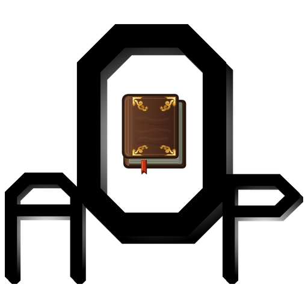

# AOP: Thaumcraft 4

**Полная версия порта и первое дополнение (Thaumic Tinkerer) будут доступны в ближайшие дни. Следите за обновлениями!**



Неофициальный порт **Thaumcraft 4.2.3.5** на **Minecraft 1.21.1**, NeoForge и Java 21.

[English](README.md) | [Разработка дополнений](docs/addons/README.ru.md) | [Авторство](NOTICE.md)

> **Personal use only.** Thaumcraft and all of its assets belong to Azanor. This repository contains the original mod's logic and assets and is not intended for redistribution.

Источником вдохновения послужил проект [Thaumcraft 3: Reforged](https://github.com/notlikethiss/thaumcraft-3-reforged).

## О проекте

Порт включает исследования, аспекты, узлы ауры, жезлы и посохи, алхимию, инфузию, сети эссенции, големов, снаряжение и Внешние земли. Для расширения содержимого предусмотрены публичный API и отдельный SDK дополнений.

Версия **1.0.0** предназначена для тестирования. Автоматические проверки охватывают правила API и отдельные игровые сценарии. Ручная проверка графики и многопользовательских сценариев продолжается. Хранилище Hidden Magic Box не реализовано.

## Требования

| Компонент | Поддерживаемая версия | Обязательность |
| --- | --- | --- |
| Minecraft | 1.21.1 | Обязательно |
| Java | 21 | Обязательно |
| NeoForge | От 21.1.252 до 21.2, не включая 21.2 | Обязательно |
| Curios | От 9.5.1+1.21.1 до 10, не включая 10 | Обязательно |
| AOP: UI | Совместимая сборка 0.7.x | На клиенте и сервере |
| TerraBlender | От 4.1.0.8 до 4.2, не включая 4.2 | Необязательно |

Все зависимости должны быть предназначены для Minecraft 1.21.1 и NeoForge. При отсутствии TerraBlender используется встроенный механизм размещения биомов.

## Установка

1. Установить Minecraft, Java, NeoForge и обязательные зависимости.
2. Поместить `thaumcraft-1.21.1-1.0.0.jar` в каталог `mods` клиента и сервера.
3. Установить совместимый игровой JAR AOP: UI с обеих сторон.

Публичный API включён в игровой JAR. Отдельные API и sources JAR предназначены для разработки и не устанавливаются как моды. Перед проверкой обновлений рекомендуется резервное копирование существующих миров.

### Связанные проекты

- **Thaumic Tinkerer** добавляет устройства, набалдашники и содержимое KAMI. Требуется совместимая сборка ядра.
- **AOP:TC4 Compact** предоставляет необязательную интеграцию рецептов JEI/EMI и подсказки Jade/WTHIT. Эти интеграции отделены от ядра.
- **AOP: UI** предоставляет общий интерфейс настроек.

## Настройка и управление

Таумономикон описывает исследования и развитие. Таумометр открывает аспекты при сканировании объектов.

| Клавиша по умолчанию | Действие |
| --- | --- |
| F | Выбор набалдашника |
| H | Переключение подвески |
| G | Изменение режима архитектора |
| Shift+G | Изменение оси архитектора |

Назначения клавиш изменяются в настройках Minecraft.

Клиентская конфигурация находится в `config/thaumcraft-client.toml`, серверная - в каталоге мира. Общее меню настроек открывается через Mods, шестерёнку Таумономикона или кнопку AOP: UI в меню паузы.

Клиентские изменения сохраняются сразу. Серверные изменения применяются кнопкой **«Сохранить»** или клавишей **Esc**. В многопользовательской игре требуется OP 4; владелец одиночного мира может менять настройки без включения читов. Параметры с меткой перезапуска сохраняют действующее значение до перезапуска. Исходные ключи конфигурации и значения по умолчанию сохранены.

## Сборка из исходников

Сначала необходимо собрать AOP: UI и указать её игровой JAR как зависимость Gradle. При установленном JDK 21 из корня этого репозитория выполняется команда:

```powershell
./gradlew.ps1 build -PaopUiJar=C:/dependencies/aopui-1.21.1-0.7.0.jar
```

В Linux и macOS используется `sh ./gradlew` с теми же задачами и параметрами. Зависимости загружаются при первой сборке. Версии Minecraft и NeoForge определены в `gradle.properties`.

| Результат | Назначение |
| --- | --- |
| `mod/build/libs/thaumcraft-1.21.1-1.0.0.jar` | Игровой мод |
| `api/build/libs/thaumcraft-api-1.0.0.jar` | Зависимость для разработки дополнений |
| `mod/build/libs/thaumcraft-1.21.1-1.0.0-sources.jar` | Архив исходников |

Задача `:mod:runClient` запускает клиент разработки, `addonSdk` собирает SDK дополнений. Обе команды принимают тот же параметр `aopUiJar`. Установка SDK, форматы данных и контракты API описаны в [руководстве разработчика дополнений](docs/addons/README.ru.md).

## Проверки и непрерывная интеграция

`build` компилирует проект и выполняет проверки API и отдельных правил. Игровые сценарии размещены в отдельных проверочных наборах исходников и исключены из игрового JAR. Успешная сборка и проверка в игре учитываются отдельно.

CI запускается при изменении исходников и сборочных файлов. Правки только документации сборку не запускают. Push в `main` сохраняет отдельный канал ночных сборок.

Для выпуска обычного GitHub Release откройте **Actions → Build and release → Run workflow** и включите **release**. Релиз получает тег `v<версия>`. Пустое поле **version** использует `mod_version` из `gradle.properties`; значение `major.minor.patch` переопределяет версию только для этого запуска. Выбранная версия применяется к метаданным JAR, именам файлов и тегу; исходные файлы workflow не изменяет. Суффиксы предварительных версий в режиме релиза отклоняются. Существующие теги релизов не перезаписываются. При выключенном **release** ручной запуск только собирает артефакты. Локальный `act` ничего не публикует. Заметки обычного релиза содержат все коммиты после ближайшего предыдущего обычного релиза в выбранной истории, ссылки на коммиты и сравнение. Первый релиз включает всю историю. В nightly этот список не добавляется.

Для локального запуска `act` подготовьте совместимые исходники зависимостей в `.dependencies/aopui`, затем выполните `act workflow_dispatch --input release=true`. Локальная проверка использует эти каталоги и пропускает публикацию на GitHub. Для приватных зависимостей задайте необязательный секрет `DEPENDENCY_TOKEN` с правом чтения соответствующих репозиториев.

| Переменная репозитория | Назначение |
| --- | --- |
| `AOPUI_REPOSITORY` | Исходники AOP: UI; `Salossov/aop-ui` |
| `AOPUI_REF` | Ревизия AOP: UI; по умолчанию `main` |

Сообщение об ошибке должно содержать версии компонентов, шаги воспроизведения, ожидаемое и фактическое поведение, а также соответствующий журнал или отчёт о сбое. Учётные данные и личные сведения необходимо удалить из вложений.

## Авторы и условия использования

- [Azanor](https://www.curseforge.com/minecraft/mc-mods/thaumcraft) - оригинальный Thaumcraft, механики и ресурсы.
- CovertJaguar, Dan Scott, Lorc, bonemouse, Scott Killen, Rorax и chicken_bones - участники, указанные в оригинальном проекте.
- [Salossov](https://github.com/Salossov) - порт на Minecraft 1.21.1 и сопровождение.
- [NeoForge](https://github.com/neoforged/NeoForge), Curios и TerraBlender - платформа и интеграции.

Авторство и область действия лицензий описаны в [NOTICE.md](NOTICE.md). `TEMPLATE_LICENSE.txt` относится только к сборочному шаблону и не распространяет MIT на Thaumcraft или его ресурсы. Проект неофициальный.
